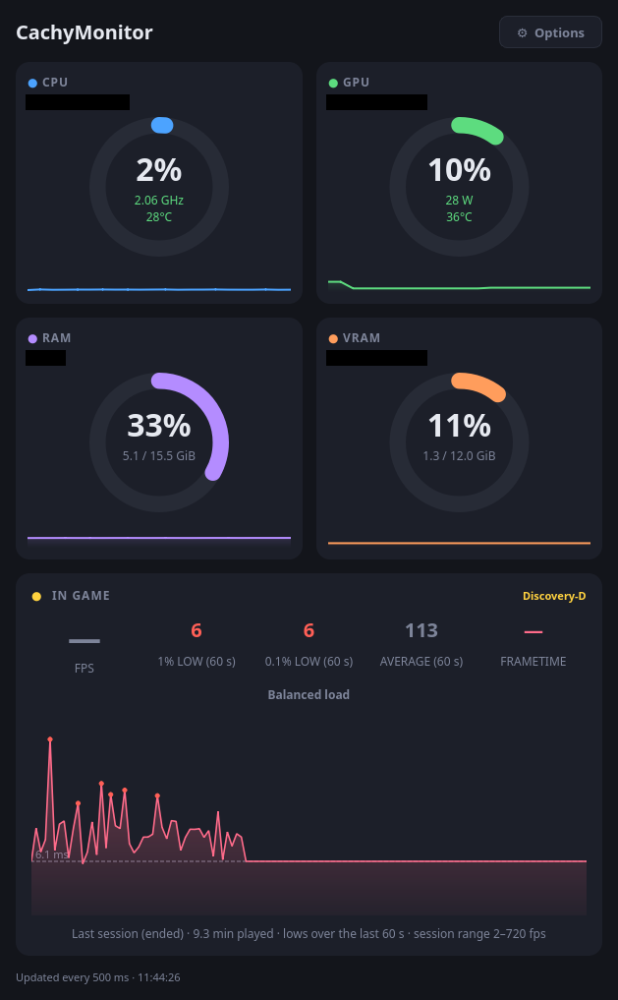
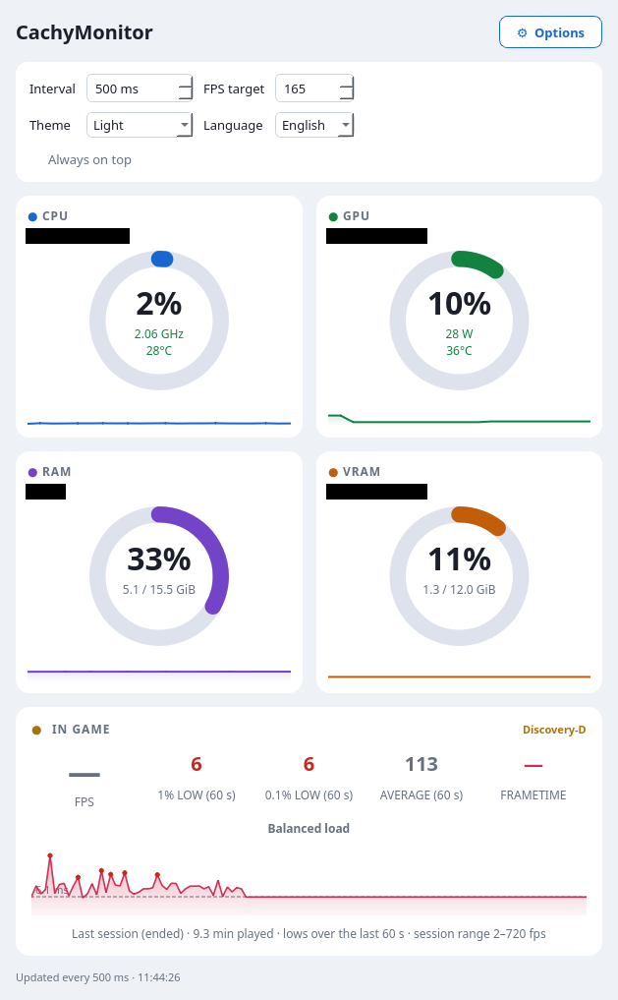
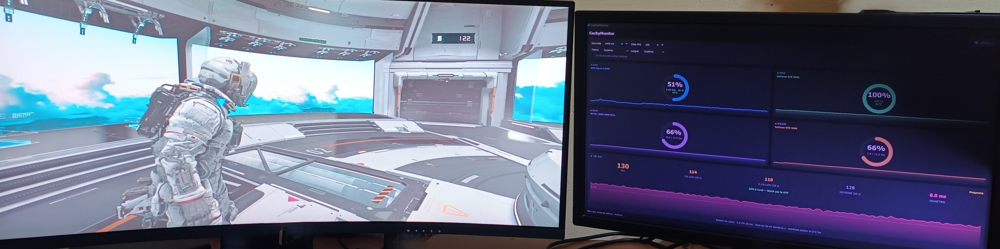

# CachyMonitor

[English](README.md) | **Français**

Pour **Windows 11**. Disponible sur **winget**, le gestionnaire de paquets officiel de Windows. Dans un
terminal (PowerShell ou Invite de commandes) :

```powershell
winget install cachymonitor
```

Ou **[télécharger l'installateur Windows (CachyMonitor-Setup.exe)](https://github.com/YOUNES-2-wq/cachymonitor/releases/latest)**.

On double-clique, on installe, ça marche : ni Python ni PySide6 à installer, tout est
dans l'exécutable. Au programme : statistiques de
session (1 % low, 0.1 % low, moyenne), graphe de frametime, détection du goulot
d'étranglement CPU/GPU, thème clair/sombre et interface en français ou en anglais.

> **Sous Windows, [MSI Afterburner](https://www.msi.com/Landing/afterburner) reste
> conseillé.** Il est gratuit et livré avec RivaTuner (RTSS). Sans lui, l'application
> affiche l'usage CPU, la RAM, le GPU **et les FPS**, grâce à PresentMon d'Intel, inclus
> depuis la 1.5.0. Sur un **AMD Ryzen**, la température et la consommation du CPU
> s'affichent aussi depuis la 1.7.0, grâce au pilote PawnIO. Sur **Intel**, elles restent
> vides sans Afterburner : Windows n'expose pas ces capteurs directement.
> [Détails](#prérequis--msi-afterburner-et-rivatuner)

> **Version Windows testée sur une seule machine.** AMD Ryzen 5 5600 + NVIDIA RTX 3060
> sous Windows 11 Pro 24H2, et rien d'autre. Sur une Radeon, un CPU Intel ou un GPU
> intégré, le code existe mais **n'a jamais été exécuté**. Si vous l'essayez, dites-moi
> ce que ça donne : [Discussions](https://github.com/YOUNES-2-wq/cachymonitor/discussions).
> C'est le seul moyen que j'aie de savoir si ça marche ailleurs que chez moi.

[Aller directement à l'installation Windows](#installation-sur-windows-11)

---

Moniteur système léger : **CPU, GPU, RAM, VRAM, températures et FPS**, avec graphes temps réel, plus la **batterie de ta manette**. Pour **Windows 11**.

> Une **version Linux** existe : [CachyMonitor pour Linux](https://github.com/YOUNES-2-wq/cachymonitor-linux).

> ℹ️ Projet communautaire indépendant, créé par un utilisateur de CachyOS. **Non affilié à l'équipe officielle de CachyOS** — le nom traduit simplement l'affection pour la distribution.



*Jauges CPU / GPU / RAM / VRAM avec températures et courbes de tendance, et en bas les statistiques de session : FPS, 1 % low, 0.1 % low, frametime et goulot d'étranglement CPU/GPU.*



*Thème clair, panneau Options ouvert : intervalle de rafraîchissement, cible FPS, thème (clair / sombre / système), langue et affichage au-dessus des autres fenêtres.*



**L'application parfaite pour mon deuxième écran.**

> 🌍 **Langue** — l'interface suit par défaut la langue du système (la locale Windows) :
> **français** si le bureau l'est, **anglais** partout ailleurs. Elle se change aussi
> à la main, à chaud, dans le panneau **⚙ Options → Langue** (Système / English /
> Français) ; le choix est mémorisé. Ajouter une langue = ajouter une entrée au
> dictionnaire `TRANSLATIONS` en haut de `cachymonitor.py`, les contributions sont
> bienvenues.

## Pourquoi CachyMonitor ?

Je suis un gamer et j'aime jouer à plusieurs jeux sur CachyOS. Je cherchais une application capable de monitorer mon matériel et de me donner un maximum d'informations sur le comportement de mes composants pendant le jeu — mais je n'ai trouvé aucun moniteur système pensé spécialement pour les jeux. J'ai donc décidé de créer le mien.

Comme je n'ai aucune formation de développeur, j'ai sollicité l'aide de mon ami IA, Claude, qui m'a énormément aidé. Le résultat a été tellement bluffant que j'ai eu envie de partager cette application avec toute personne qui souhaite l'essayer.

## Une première du genre 🚀

CachyMonitor mesure les FPS avec **PresentMon** et **RivaTuner (RTSS)**, et
**transforme ces mesures en véritables statistiques de session**, dans une fenêtre à
part, plutôt qu'un overlay par-dessus le jeu.

À ma connaissance, c'est **la première application de ce genre** — une fenêtre
compagnon, distincte du jeu, qui réunit dans une seule interface visuelle :

- les **statistiques de session calculées** — 1 % low, 0,1 % low, moyenne, pics de
  frametime (micro-saccades) et **goulot d'étranglement CPU vs GPU** ;
- les **jauges de composants en direct** — CPU, GPU, RAM, VRAM, fréquences,
  consommation et températures, avec courbes de tendance ;
- le tout **sans overlay** qui s'affiche par-dessus le jeu, dans une appli légère
  (un seul fichier Python, une seule dépendance) ;
- la **manette** : modèle, connexion câble ou Bluetooth et niveau de batterie,
  pour ne plus se faire surprendre en pleine partie ;
- en **thème clair ou sombre**, au choix ou en suivant automatiquement le bureau.

Les briques existaient déjà (RivaTuner, PresentMon…), mais personne ne les avait
assemblées en un **tableau de bord compagnon pensé pour le jeu**. C'est toute
l'idée de CachyMonitor : ne pas réinventer la mesure, mais la rendre **lisible et
analysable**.

## Installation sur Windows 11

### Avec winget (recommandé)

CachyMonitor est publié dans le catalogue officiel de **winget**, le gestionnaire de
paquets intégré à Windows 11. Ouvrir un terminal (PowerShell ou Invite de commandes)
et taper :

```powershell
winget install cachymonitor
```

Les mises à jour s'installent ensuite avec :

```powershell
winget upgrade cachymonitor
```

### Avec l'installateur

**[Télécharger CachyMonitor-Setup.exe](https://github.com/YOUNES-2-wq/cachymonitor/releases/latest)**,
puis double-cliquer. L'assistant propose d'installer pour tous les utilisateurs ou pour
vous seul, crée les raccourcis (bureau + menu Démarrer) et s'enlève proprement depuis
*Paramètres → Applications*. **Python n'est pas nécessaire** : tout est dans l'exécutable.

> **Windows peut afficher un avertissement bleu « Windows a protégé votre ordinateur ».**
> C'est normal et ce n'est pas un virus : l'installateur n'est pas signé numériquement,
> car un certificat coûte plusieurs centaines d'euros par an pour un projet gratuit.
> Cliquez sur **Informations complémentaires** puis **Exécuter quand même**.
> Cet avertissement dépend de la réputation du fichier chez Microsoft : il apparaît
> surtout sur les téléchargements récents et se raréfie avec le temps. Le code source
> est entièrement lisible ici, et vous pouvez reconstruire l'installateur vous-même
> (voir plus bas).

### Prérequis : MSI Afterburner et RivaTuner

**À lire avant de s'étonner que des valeurs soient vides.** Sous Windows, CachyMonitor
ne mesure pas tout le matériel lui-même : Windows n'expose pas la plupart des capteurs
directement. L'application s'appuie donc sur **MSI Afterburner**, que la plupart des joueurs font déjà tourner.

| Pour obtenir | Il faut |
|---|---|
| Température et consommation du CPU | **AMD Ryzen :** le pilote **PawnIO** (facultatif, voir plus bas, depuis la 1.7.0). **Intel**, ou sans PawnIO : **[MSI Afterburner](https://www.msi.com/Landing/afterburner)** (gratuit) |
| FPS et statistiques de session (1 % low, 0.1 % low…) | **PresentMon**, inclus dans l'installateur. Sinon **RivaTuner (RTSS)**, installé avec Afterburner |
| Usage CPU, fréquence réelle, RAM, nom du processeur | rien, ça marche partout (fréquence lue par un compteur de performance Windows depuis la 1.5.1) |
| GPU, VRAM, température GPU | rien sur NVIDIA (bibliothèque NVML du pilote, puis `nvidia-smi`) ; Afterburner sinon |

**Ce qu'il faut faire :** installer Afterburner, le laisser tourner (il démarre RTSS
tout seul), et c'est fini. Aucun réglage à faire dans CachyMonitor.

**Sans Afterburner**, l'application démarre et reste utilisable : usage CPU, RAM, GPU,
VRAM, FPS et fréquence réelle du CPU s'affichent normalement. Sur un AMD Ryzen avec
PawnIO (voir plus bas), la température et la consommation du CPU aussi. Sinon, elles
restent à `—` (un repli existe pour la seule température, via
[LibreHardwareMonitor](https://github.com/LibreHardwareMonitor/LibreHardwareMonitor)).

> Les chiffres viennent **de la même source que l'OSD de RivaTuner** : le FPS affiché par
> CachyMonitor est exactement celui que vous voyez en jeu, sans écart de calcul.

### FPS sans Afterburner : PresentMon

Depuis la 1.5.0, l'installateur inclut **[PresentMon](https://github.com/GameTechDev/PresentMon)**,
l'outil d'Intel (licence MIT) qui mesure chaque image affichée grâce aux traces de
Windows. Il ne s'injecte pas dans le jeu, et il est sans danger avec les anti-triches :
testé sur eFootball.

- **PresentMon passe en premier depuis la 1.6.0.** Il suit le jeu même quand ce n'est
  plus la fenêtre active (Afterburner ne donne les FPS que du jeu au premier plan).
  RivaTuner prend le relais quand PresentMon ne mesure rien, par exemple pour un jeu en
  fenêtre classique. La ligne d'état indique la source utilisée.
- **Une case de l'installateur**, « Autoriser PresentMon », ajoute votre compte au groupe
  Windows « Utilisateurs du journal de performances ». Windows demande alors les droits
  administrateur, et il faut se déconnecter puis se reconnecter une fois. Sans ce groupe,
  PresentMon n'a pas le droit de mesurer, et CachyMonitor l'indique.
- **Le jeu doit être en plein écran ou en fenêtre sans bord** quand il est au premier
  plan. C'est ce qui évite de prendre un navigateur ou un dock pour un jeu. Un jeu en
  fenêtre classique reste mesuré par RivaTuner.
- Pour retirer votre compte du groupe plus tard, dans un terminal administrateur :
  `Remove-LocalGroupMember -SID S-1-5-32-559 -Member VotreNom`

### Température CPU sans Afterburner : PawnIO (AMD Ryzen, depuis la 1.7.0)

**[PawnIO](https://pawnio.eu)** est un petit pilote open source, signé par Microsoft,
également utilisé par LibreHardwareMonitor et FanControl. Il n'exécute que des modules
signés qui n'autorisent qu'une liste fixe de lectures. CachyMonitor utilise le module AMD
officiel ([PawnIO.Modules](https://github.com/namazso/PawnIO.Modules), LGPL 2.1, non
modifié) pour lire la température et le compteur d'énergie du processeur. **Rien n'est
jamais écrit dans le processeur.** Testé sur un Ryzen 5 5600 : mêmes valeurs
qu'Afterburner (à 0,1 °C et environ 1 W près), et aucun souci avec l'anti-triche
d'eFootball.

- **Trois étapes, toutes facultatives et désactivées par défaut :**
  1. Installer CachyMonitor **pour tous les utilisateurs** (choix de l'installateur, ou
     `winget install YOUNES-2-wq.CachyMonitor --scope machine`). Il est alors dans
     Program Files, un dossier que seul un administrateur peut modifier. CachyMonitor
     refuse de tourner en administrateur depuis un autre dossier : sinon, un programme
     ordinaire pourrait remplacer l'un de ses fichiers et profiter de votre « Oui » à
     l'invite UAC.
  2. Installer PawnIO, s'il n'est pas déjà là (FanControl et LibreHardwareMonitor
     l'installent aussi) : case de l'installateur (seulement sur AMD), ou
     `winget install namazso.PawnIO`.
  3. Dans les **Options** de CachyMonitor, cocher **« Température CPU par PawnIO »**.
     Le changement prend effet au lancement suivant. S'il manque quelque chose, la case
     est grisée et son infobulle dit pourquoi.
- **Le pilote ne répond qu'aux programmes administrateur.** Une fois la case cochée,
  CachyMonitor se relance donc en administrateur au démarrage, et **Windows demande une
  confirmation (UAC) à chaque lancement**. Répondez « Non » et l'appli s'ouvre
  normalement, comme en 1.6.0 (valeurs d'Afterburner). Décochez la case et plus rien
  n'est demandé. Sur un compte standard (non administrateur), rien n'est demandé.
- Désinstaller CachyMonitor laisse PawnIO en place (d'autres logiciels s'en servent) ;
  il a sa propre entrée dans « Applications installées ».
- **Processeurs Intel :** pas encore pris en charge par cette méthode ; Afterburner reste
  nécessaire.

### Reconstruire l'installateur soi-même

```powershell
python -m pip install pyinstaller pyside6 psutil
winget install JRSoftware.InnoSetup
powershell -ExecutionPolicy Bypass -File packaging\windows\build.ps1
```

Le résultat apparaît dans `dist\`.

### Lancer sans installer (depuis les sources)

```powershell
python -m pip install pyside6 psutil
python cachymonitor.py
```

## Sources des données

| Métrique       | Source                                                      |
|----------------|-------------------------------------------------------------|
| CPU usage/cœur | psutil                                                      |
| CPU fréquence  | compteur de performance Windows, puis Afterburner           |
| CPU temp       | PawnIO (AMD), Afterburner, puis LibreHardwareMonitor        |
| CPU conso      | PawnIO (AMD), puis Afterburner                              |
| RAM            | psutil + `Win32_PhysicalMemory`                             |
| GPU / VRAM     | NVML, `nvidia-smi`, puis capteurs Afterburner               |
| FPS / session  | **PresentMon** ; **RivaTuner (RTSS)** en secours, relevé toutes les 100 ms |
| Manettes       | HID brut *(Sony)*, XInput *(Xbox)*                          |

> Pourquoi 100 ms : les « lows » ont besoin de beaucoup de points. À une mesure par
> seconde, le 0.1 % low serait calculé sur 60 valeurs par minute et ne voudrait plus
> rien dire.

Rien à configurer pour les FPS : **PresentMon**, inclus dans l'installateur, les
mesure, et **RivaTuner (RTSS)** prend le relais s'il ne mesure rien.

## Mises à jour

Quelques secondes après son démarrage, puis toutes les 6 heures tant qu'il reste ouvert,
CachyMonitor demande à GitHub (`api.github.com`) s'il existe une version plus récente.
Rien sur votre PC n'est envoyé. S'il y en a une, une barre apparaît en haut de la
fenêtre : **Mettre à jour** télécharge l'installateur, vérifie son empreinte SHA-256
contre celle que publie GitHub, l'installe en silence et relance l'application. Cette
vérification est activée par défaut ; décochez **Rechercher les mises à jour au
démarrage** dans les Options pour la désactiver.

## Compatibilité matérielle

CachyMonitor vise **tout matériel**, mais tout n'est pas vérifié.

| | CPU | GPU |
|---|---|---|
| **AMD** | ✅ testé (PawnIO et Afterburner) | ⚠️ écrit, non testé (capteurs Afterburner) |
| **Intel** | ⚠️ écrit, non testé (via Afterburner) | ⚠️ écrit, non testé (capteurs Afterburner) |
| **NVIDIA** | — | ✅ testé (`nvidia-smi`) |

L'usage CPU, la RAM et le nom du processeur ne dépendent d'aucun
matériel particulier et fonctionnent partout. À l'inverse, sur une carte non-NVIDIA
le repli Afterburner affichera la carte sous le nom générique « GPU » et laissera la
jauge VRAM à 0 % — Afterburner ne publie pas la VRAM totale.

**Manettes** : ✅ testé avec une **DualSense (PS5)**, en Bluetooth **et**
en USB-C — les deux cas sont bien différents, Windows n'offrant pas la même façon
de lire la manette sur l'un et sur l'autre. La DualShock 4 est écrite d'après la
documentation mais ⚠️ **non testée**. Les manettes **Xbox** passent par XInput, qui
ne publie ni le modèle ni un pourcentage, seulement quatre niveaux de batterie :
⚠️ écrit, non testé faute de manette Xbox sous la main.

> Si une manette Sony est traduite en manette Xbox par **Steam** ou **DS4Windows**,
> elle peut apparaître deux fois dans la carte : rien ne permet de relier la manette
> virtuelle à son original, et masquer un doublon risquerait de masquer une vraie
> seconde manette.

**Configuration réellement vérifiée** : AMD Ryzen 5 5600 + NVIDIA RTX 3060, sous
Windows 11 Pro 24H2 avec MSI Afterburner et RivaTuner (RTSS 7.x).

Le reste est écrit d'après la documentation, sans matériel sous la main pour
l'exécuter. L'application ne plantera pas si un capteur manque : la valeur
concernée affiche simplement `—`.

### J'ai besoin de vous 🙏

J'ai créé CachyMonitor seul, et je n'ai **qu'une seule machine** pour le tester
(AMD Ryzen 5 5600 + NVIDIA RTX 3060). Autrement dit : **je n'ai aucune idée de la
façon dont l'application se comporte sur un autre matériel que le mien.**

Un Radeon, un CPU Intel, un GPU intégré… chaque configuration est différente, et
sans vous, ces cas resteront des angles morts. C'est vraiment là que j'ai besoin
de la communauté : **votre commentaire est le seul moyen de savoir comment l'app
réagit sur votre matériel**, et donc de l'améliorer pour tout le monde.

> Deux scripts de diagnostic sont fournis dans `scripts/` :
> `test_afterburner.py` liste tous les capteurs qu'Afterburner publie sur votre machine,
> et `test_rtss.py` inspecte la mémoire partagée de RivaTuner. Si une valeur reste vide
> chez vous, leur sortie me dira pourquoi bien mieux qu'une capture d'écran.

Pas besoin d'être développeur, ni de lancer quoi que ce soit. Un simple mot —
« chez moi tout marche » ou « la température GPU affiche `—` » — m'aide déjà
énormément. Racontez-moi votre config et ce que vous voyez, ça compte pour moi 🙂

**➡️ [Laisser un commentaire (Discussions)](https://github.com/YOUNES-2-wq/cachymonitor/discussions)**

## Licence

[MIT](LICENSE) — tu peux utiliser, modifier et redistribuer ce code
librement, à condition de conserver la mention de copyright.
