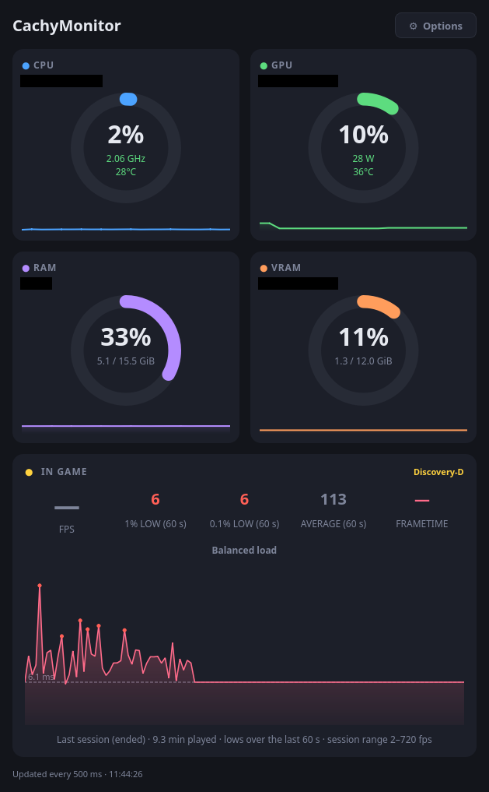
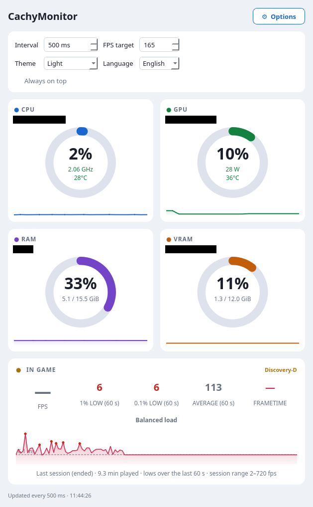
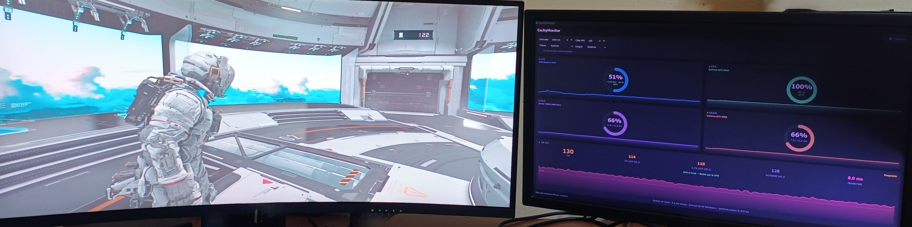

# CachyMonitor

**English** | [Français](README.fr.md)

A lightweight gaming system monitor for a second screen: **CPU, GPU, RAM, VRAM,
temperatures and FPS** with real-time graphs, session statistics (1% low, 0.1% low,
frametime, CPU/GPU bottleneck) and your **controller's battery level**, for
**Windows 11**.

```powershell
winget install cachymonitor
```

Or **[download the Windows installer (CachyMonitor-Setup.exe)](https://github.com/YOUNES-2-wq/cachymonitor/releases/latest)**.

> A **Linux version** is available: [CachyMonitor for Linux](https://github.com/YOUNES-2-wq/cachymonitor-linux).

> Independent community project, made by a CachyOS user. **Not affiliated with the
> official CachyOS team**; the name is just a nod to the distribution.



*CPU / GPU / RAM / VRAM gauges with temperatures and trend graphs. At the bottom, the
session statistics: FPS, 1% low, 0.1% low, frametime and CPU/GPU bottleneck.*



*Light theme with the Options panel open: refresh interval, FPS target, theme (light /
dark / system), language and always-on-top.*



**The perfect app for my second screen.**

> **Language**: the interface follows the system language by default (the Windows locale): **French** if your desktop is in French,
> **English** everywhere else. You can also switch it live in **Options > Language**
> (System / English / Français); the choice is remembered. Adding a language means
> adding an entry to the `TRANSLATIONS` dictionary at the top of `cachymonitor.py`.
> Contributions are welcome.

## Why CachyMonitor?

I'm a gamer and I play a lot of games on CachyOS. I wanted an app that could monitor my
hardware and tell me as much as possible about how my components behave while I play,
but I couldn't find a system monitor designed specifically for gaming. So I decided to
make my own.

**I'm not a developer.** I built CachyMonitor with a lot of help from an AI assistant,
Claude. I'm saying this upfront because I think you should know. The result surprised me
so much that I wanted to share it with anyone who'd like to try it. The whole program is
a single readable Python file, so anyone can check what it does.

## What it does

CachyMonitor measures FPS with **PresentMon** and **RivaTuner (RTSS)**, and **turns those
measurements into real session statistics** in a separate window, instead of an overlay
on top of the game.

It is a companion window, separate from the game, that brings together in one interface:

- **computed session statistics**: 1% low, 0.1% low, average, frametime spikes
  (micro-stutters) and a **CPU vs GPU bottleneck** indicator;
- **live component gauges**: CPU, GPU, RAM, VRAM, clock speeds, power draw and
  temperatures, with trend graphs;
- **no overlay** drawn on top of the game, in a light app (one Python file, one
  dependency);
- your **controller**: model, wired or Bluetooth connection and battery level, so it
  doesn't die on you mid-game;
- a **light or dark theme**, chosen by you or following your desktop automatically.

The building blocks already existed (RivaTuner, PresentMon...), but as far as I
know nobody had put them together into a **companion dashboard built for gaming**. That's
the whole idea: not reinventing the measurements, but making them **readable and easy to
analyse**.

## Install on Windows 11

### With winget (recommended)

CachyMonitor is published in the official catalogue of **winget**, the package manager
built into Windows 11. Open a terminal (PowerShell or Command Prompt) and type:

```powershell
winget install cachymonitor
```

To update later:

```powershell
winget upgrade cachymonitor
```

### With the installer

**[Download CachyMonitor-Setup.exe](https://github.com/YOUNES-2-wq/cachymonitor/releases/latest)**
and double-click it. The setup wizard lets you install for all users or just for you,
creates shortcuts (desktop and Start menu) and uninstalls cleanly from
*Settings > Apps*. **Python is not needed**: everything is bundled.

> **Windows may show a blue "Windows protected your PC" warning.** This is expected and
> it is not a virus: the installer isn't digitally signed, because a code-signing
> certificate costs several hundred euros a year, which is a lot for a free project.
> Click **More info**, then **Run anyway**. This warning depends on the file's
> reputation with Microsoft: it mostly shows up on recent downloads and fades over
> time. The source code is fully readable here, and you can rebuild the installer
> yourself (see below).

### Requirements: MSI Afterburner and RivaTuner

**Read this before wondering why some values are empty.** On Windows, CachyMonitor
doesn't measure all the hardware itself: Windows doesn't expose most sensors directly.
So the app relies on **MSI Afterburner**, which most PC gamers already run.

| To get | You need |
|---|---|
| CPU temperature and power draw | **AMD Ryzen:** the **PawnIO** driver (optional, see below, since 1.7.0). **Intel**, or without PawnIO: **[MSI Afterburner](https://www.msi.com/Landing/afterburner)** (free) |
| FPS and session statistics (1% low, 0.1% low...) | **PresentMon**, included in the installer. Otherwise **RivaTuner (RTSS)**, installed with Afterburner |
| CPU usage, real clock speed, RAM, processor name | nothing, works everywhere (clock speed from a Windows performance counter since 1.5.1) |
| GPU, VRAM, GPU temperature | nothing on NVIDIA (NVML driver library, then `nvidia-smi`); Afterburner otherwise |

**What to do:** install Afterburner and leave it running (it starts RTSS by itself).
That's it. There's nothing to configure in CachyMonitor.

**Without Afterburner**, the app still starts and stays usable: CPU, RAM, GPU, VRAM and
FPS are shown normally, and so is the real CPU clock speed. On an AMD Ryzen with PawnIO
(see below), CPU temperature and power draw are shown too. Otherwise they stay at `—`
(there is a fallback for the temperature only, through
[LibreHardwareMonitor](https://github.com/LibreHardwareMonitor/LibreHardwareMonitor)).

> The numbers come **from the same source as the RivaTuner on-screen display**: the FPS
> shown by CachyMonitor is exactly the one you see in game.

### FPS without Afterburner: PresentMon

Since 1.5.0, the installer includes **[PresentMon](https://github.com/GameTechDev/PresentMon)**,
Intel's tool (MIT license) that measures every displayed frame through Windows event
tracing. It doesn't inject anything into the game, and it's safe with anti-cheats:
tested on eFootball.

- **PresentMon comes first since 1.6.0.** It keeps following the game even when it's
  no longer the active window (Afterburner only reports the FPS of the foreground game).
  RivaTuner takes over when PresentMon measures nothing, for example a game in a regular
  window. The status line shows which source is used.
- **An installer checkbox**, "Allow PresentMon", adds your account to the Windows
  "Performance Log Users" group. Windows then asks for administrator rights, and you
  need to sign out and back in once. Without this group, PresentMon isn't allowed to
  measure, and CachyMonitor tells you so.
- **The game must be fullscreen or borderless windowed** while it's in the foreground.
  That's what keeps a browser or a dock from being taken for a game. A game in a regular
  window is still measured by RivaTuner.
- To remove your account from the group later, in an administrator terminal:
  `Remove-LocalGroupMember -SID S-1-5-32-559 -Member YourName`

### CPU temperature without Afterburner: PawnIO (AMD Ryzen, since 1.7.0)

**[PawnIO](https://pawnio.eu)** is a small open source driver, signed by Microsoft, also
used by LibreHardwareMonitor and FanControl. It only runs signed modules that allow a
fixed list of reads. CachyMonitor uses the official AMD module
([PawnIO.Modules](https://github.com/namazso/PawnIO.Modules), LGPL 2.1, unmodified) to
read the CPU temperature and the CPU energy counter. **Nothing is ever written to the
processor.** Tested on a Ryzen 5 5600: same values as Afterburner (within 0.1 °C and
about 1 W), and no trouble with eFootball's anti-cheat.

- **Three steps, all optional and off by default:**
  1. Install CachyMonitor **for all users** (installer choice, or
     `winget install YOUNES-2-wq.CachyMonitor --scope machine`). It then lives in
     Program Files, a folder only an administrator can modify. CachyMonitor refuses to
     run as administrator from any other folder: otherwise an ordinary program could
     replace one of its files and take advantage of your "Yes" to the UAC prompt.
  2. Install PawnIO, if it's not already there (FanControl and LibreHardwareMonitor
     install it too): installer checkbox (AMD only), or `winget install namazso.PawnIO`.
  3. In CachyMonitor's **Options**, tick **"CPU temperature via PawnIO"**. It takes
     effect at the next launch. If something is missing, the box is greyed out and its
     tooltip says why.
- **The driver only answers to administrator programs.** So once the box is ticked,
  CachyMonitor restarts itself as administrator at launch and **Windows asks for
  confirmation (UAC) each time**. Answer "No" and the app opens normally, as in 1.6.0
  (Afterburner values). Untick the box and it never asks again. On a standard
  (non-administrator) account, it never asks.
- Uninstalling CachyMonitor leaves PawnIO in place (other programs use it); it has its
  own entry in "Installed apps".
- **Intel processors:** not supported by this method yet; Afterburner is still needed.

### Rebuild the installer yourself

```powershell
python -m pip install pyinstaller pyside6 psutil
winget install JRSoftware.InnoSetup
powershell -ExecutionPolicy Bypass -File packaging\windows\build.ps1
```

The result appears in `dist\`.

### Run without installing (from source)

```powershell
python -m pip install pyside6 psutil
python cachymonitor.py
```

## Data sources

| Metric          | Source                                                      |
|-----------------|-------------------------------------------------------------|
| CPU usage/core  | psutil                                                      |
| CPU clock       | Windows performance counter, then Afterburner               |
| CPU temperature | PawnIO (AMD), Afterburner, then LibreHardwareMonitor        |
| CPU power       | PawnIO (AMD), then Afterburner                              |
| RAM             | psutil + `Win32_PhysicalMemory`                             |
| GPU / VRAM      | NVML, `nvidia-smi`, then Afterburner sensors                |
| FPS / session   | **PresentMon**; **RivaTuner (RTSS)** as a fallback, sampled every 100 ms |
| Controllers     | raw HID *(Sony)*, XInput *(Xbox)*                           |

> Why 100 ms: the "lows" need a lot of data points. At one sample per second, the
> 0.1% low would be computed from 60 values per minute and would be meaningless.

On Windows there's nothing to configure for FPS: **PresentMon**, included in the
installer, measures it, and **RivaTuner (RTSS)** takes over when it measures nothing.

## Hardware compatibility

CachyMonitor aims to support **any hardware**, but not everything has been verified.

| | CPU | GPU |
|---|---|---|
| **AMD** | Tested (PawnIO and Afterburner) | Written, untested (Afterburner sensors) |
| **Intel** | Written, untested (via Afterburner) | Written, untested (Afterburner sensors) |
| **NVIDIA** | — | Tested (`nvidia-smi`) |

CPU usage, RAM and the processor name don't depend on any particular
hardware and work everywhere. On the other hand, on a non-NVIDIA card the Afterburner
fallback shows the card under the generic name "GPU" and leaves the VRAM gauge at 0%,
because Afterburner doesn't publish total VRAM.

**Controllers**: tested with a **DualSense (PS5)**, over Bluetooth **and** USB-C.
These are two quite different cases, since Windows doesn't give the same way to read the
controller in each. DualShock 4 support is written from the documentation but
**untested**. **Xbox** controllers go through XInput, which publishes neither the model
nor a percentage, only four battery levels: written, untested (no Xbox controller at hand).

> If a Sony controller is translated into an Xbox controller by **Steam** or
> **DS4Windows**, it may appear twice in the card: there's no way to link the virtual
> controller to the real one, and hiding a duplicate could hide a genuine second
> controller.

**Actually verified setup**: AMD Ryzen 5 5600 + NVIDIA RTX 3060, on Windows 11 Pro
24H2 with MSI Afterburner and RivaTuner (RTSS 7.x).

Everything else is written from the documentation, without hardware at hand to run it. The app won't crash if a sensor is missing: that value just shows `—`.

### I need your help

I made CachyMonitor on my own, and I have **only one machine** to test it on (AMD
Ryzen 5 5600 + NVIDIA RTX 3060). In other words: **I have no idea how the app behaves
on any hardware other than mine.**

A Radeon, an Intel CPU, an integrated GPU... every setup is different, and without you
those cases stay blind spots. Your feedback is the only way for me to know how
the app reacts on your hardware, and so to improve it for everyone.

> Two diagnostic scripts are included in `scripts/`:
> `test_afterburner.py` lists every sensor Afterburner publishes on your machine, and
> `test_rtss.py` inspects RivaTuner's shared memory. If a value stays empty for you,
> their output will tell me why much better than a screenshot.

You don't need to be a developer or run anything. A simple message such as "everything
works for me" or "the GPU temperature shows `—`" already helps a lot. Tell me your setup
and what you see. It really matters to me.

**[Leave a comment (Discussions)](https://github.com/YOUNES-2-wq/cachymonitor/discussions)**

## License

[MIT](LICENSE): you can use, modify and redistribute this code freely, as long as you
keep the copyright notice.
